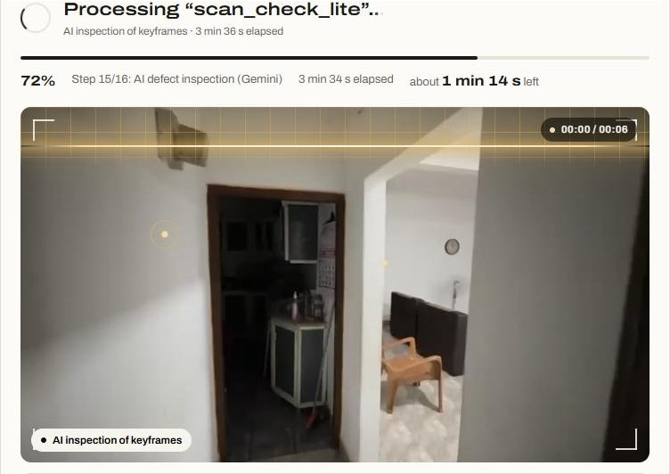
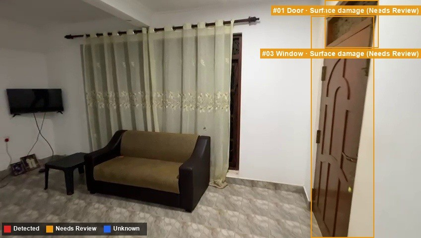
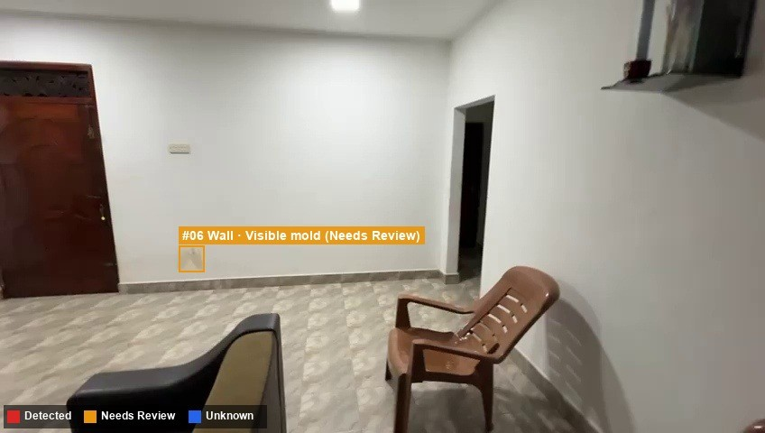
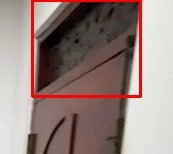
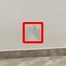
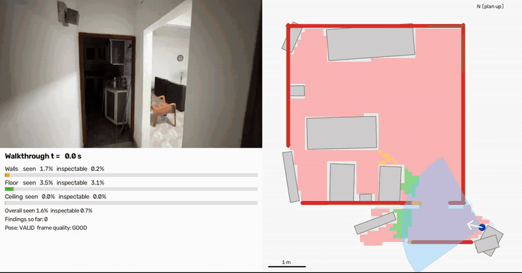
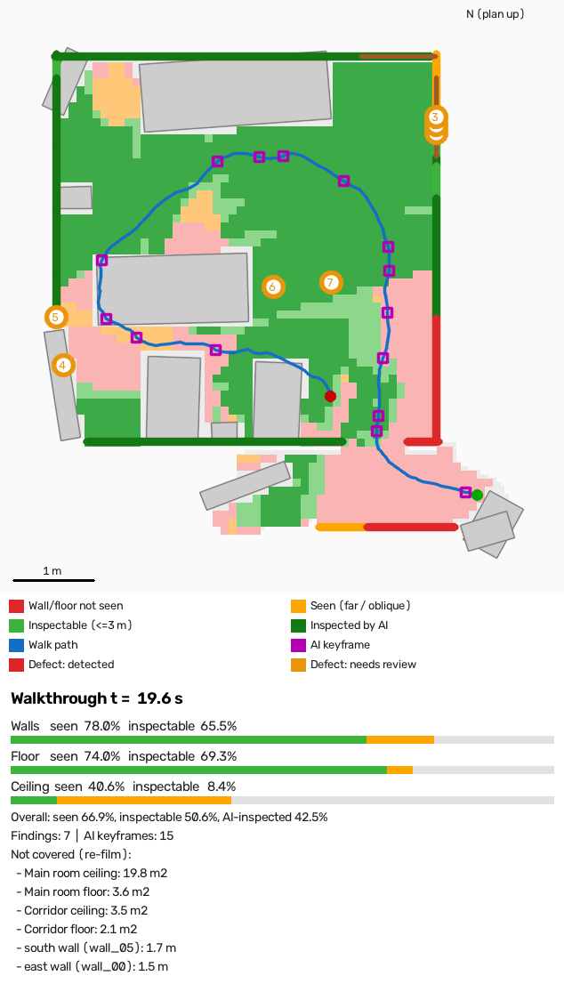
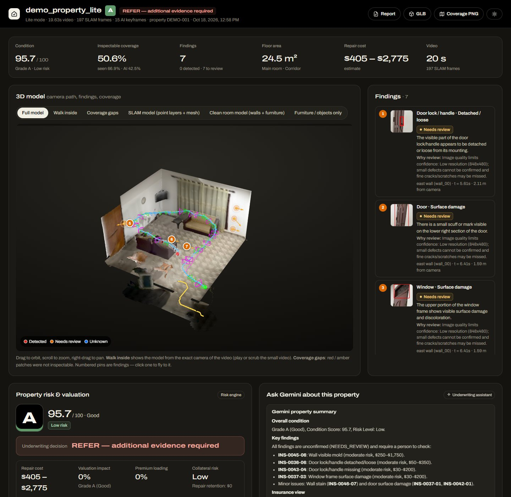
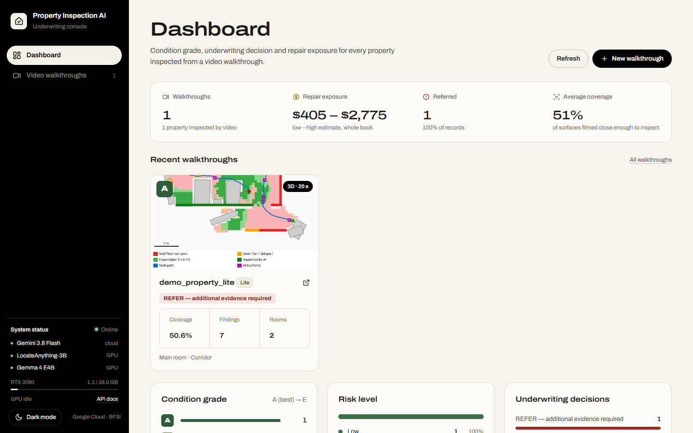
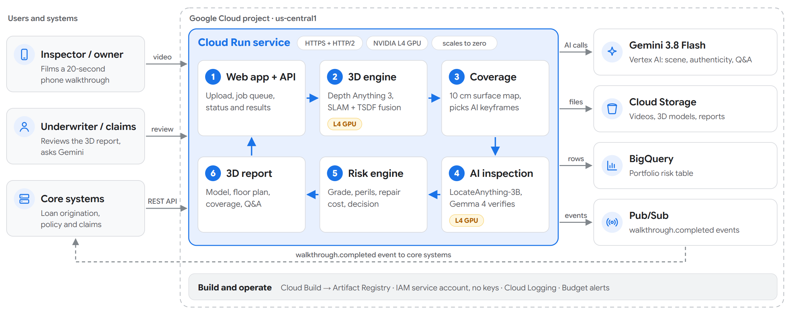

# Property Inspection AI — risk & valuation on Google Cloud

**AI property inspection for insurers, mortgage lenders and real-estate valuers.**
Upload a phone walkthrough video of a property and get, in minutes:

* every visible defect, localized and verified (cracks, water damage, mold, broken glass, rust, …)
* a **condition grade (A–E)**, **risk level**, **insurance perils**, **indicative repair-cost range**,
  **valuation / collateral impact**, **premium-loading suggestion** and an **underwriting decision** with reasons
* **evidence-integrity (fraud) signals**: the same photo reused for another property, edited photos,
  photos of a screen / renderings / AI-generated images, old photos
* for videos: a **3D model of the property**, a **2D floor plan**, and a **coverage map** that proves which
  walls / floors / ceilings were actually inspected (and which must be filmed again)
* a **Gemini underwriting assistant** that answers questions about the inspection, citing issue ids
* a **portfolio view**, with each record streamed to **BigQuery** and published as a **Pub/Sub** event

Built by **Team XCore** for the Google Cloud AI Builder Cup 2026 (BFSI track). Pitch deck and documentation: [`docs/`](docs/README.md).

## See it in action

The included sample, `samples/room_walkthrough.mp4` (a 20-second phone video of a living room and corridor), processed
in Lite mode on a laptop RTX 3080 in about 10.5 minutes: 197 frames, 15 AI keyframes, 7 findings, 50.6% of surfaces
inspectable, condition grade **A (95.7 / 100)**. The decision is **REFER: additional evidence required**, because too
little of the property was filmed close enough to inspect, and the report lists exactly which areas to film again.

**1. Upload and live scan.** While a video is processed, the progress view replays it under a scanning beam and shows
each pipeline step with an ETA.



**2. Detection on the AI keyframes.** LocateAnything-3B proposes defect boxes, Gemma 4 E4B checks a full-resolution
close-up of each box, and the rule engine marks it *Detected* or *Needs review* (amber).

<table>
  <tr>
    <td width="50%"></td>
    <td width="50%"></td>
  </tr>
  <tr>
    <td>Door and window frame: surface damage </td>
    <td>Wall: possible mold patch near the floor </td>
  </tr>
</table>

**3. Live replay.** `live_map.mp4` replays the walk: the video on the left, and on the right the floor plan filling in as
the camera moves (amber = seen, green = inspectable within 3 m, purple = AI keyframes), with coverage bars over time.



[Full-quality replay video (MP4)](docs/media/live-replay.mp4)

**4. Final coverage map.** Every 10 cm of wall, floor and ceiling is checked against every frame. The map shows the walk
path, the AI keyframes, the numbered findings, and the areas that must be filmed again.

<table>
  <tr>
    <td width="45%"></td>
    <td>
      <b>Coverage</b><br>
      Walls: seen 78%, inspectable 65.5%<br>
      Floor: seen 74%, inspectable 69.3%<br>
      Ceiling: seen 40.6%, inspectable 8.4%<br><br>
      <b>Film again</b><br>
      Main room ceiling (19.8 m²) and floor (3.6 m²)<br>
      Corridor ceiling (3.5 m²) and floor (2.1 m²)<br>
      South wall (1.7 m) and east wall (1.5 m)
    </td>
  </tr>
</table>

**5. 3D report.** The interactive 3D model with numbered finding pins (click one to fly to it), the findings list,
property risk and valuation, and the Gemini property summary and underwriting assistant.



**Dashboard.** Condition grades, risk levels, underwriting decisions and repair exposure across all walkthroughs.



**Version 1.0.0 (frozen 2026-10-16).** Hybrid AI: **Gemini 3.8 Flash** (scene + summary)
+ two small local GPU models (**LocateAnything-3B** boxes, **Gemma 4 E4B** verifier) + **Depth Anything 3** for 3D.

| Step | Model | Runs on |
|---|---|---|
| Room, components, photo authenticity | Gemini 3.8 Flash | Vertex AI / AI Studio |
| Defect boxes | LocateAnything-3B (GGUF, locate-anything.cpp) | GPU |
| First defect check | Gemma 4 E4B (GGUF, llama.cpp server) | GPU |
| Rule engine: DETECTED / NEEDS_REVIEW / NOT_DETECTED | deterministic (`fusion_service.py`) | CPU |
| Risk, grade, cost, valuation, decision | deterministic (`risk_rules.yaml`) | CPU |
| Video depth + 3D | Depth Anything 3 (DA3-BASE) + OpenCV 5 SLAM + Open3D TSDF | GPU + CPU |
| 3D object names, underwriter summary, Q&A | Gemini 3.8 Flash | cloud |

### Video modes: Lite and Advanced

Both modes run **the same AI models**, so defects, risk decision, coverage and 3D pin
positions are the same. Only the 3D build differs:

| | **Lite** | **Advanced** (default) |
|---|---|---|
| 3D surface (TSDF voxel) | 3 cm | 1.5 cm |
| Alignment passes | 1 | 2 |
| Preview videos (orbit, depth, SLAM diagnostic) | skipped | yes |
| Frames used / camera tracking | all / identical | all |
| 3D build, 20 s video, RTX 3050 laptop | **11.1 min** | 26.9 min |
| Model-vs-video match (PSNR) | 21.8 dB | 21.6 dB |
| Clean GLB size | 11 MB | 28 MB |

Choose it in the upload form, `mode=lite|advanced` on `POST /api/v1/walkthrough`, or
`scripts/inspect_walkthrough.py --mode lite`. A Lite run is stored as `<video>_lite`. Halving the frame rate
was tested and rejected: tracking broke and the room came out stretched.

## Problem → solution (BFSI track)

| Industry pain | What the app does |
|---|---|
| Insurers price and settle claims on self-reported photos; inspections are slow and costly | Automated defect detection + insurance perils + premium-loading suggestion + claim-ready report |
| Claims / valuation fraud: recycled or edited photos, photos of other properties | Perceptual-hash duplicate detection across all properties, EXIF edit and age checks, Gemini authenticity check → **REFER - evidence integrity** |
| Mortgage lenders need the collateral condition before lending | Condition grade, collateral risk, valuation impact %, repair retention suggestion |
| Remote inspections can't show what was covered | Video → 3D model + coverage map; low AI-inspected coverage → **REFER - additional evidence required** |
| Compliance / explainability of automated decisions | Deterministic rule engine and risk rules (`backend/config/risk_rules.yaml`); every decision lists its reasons; raw model outputs are archived; humans make the final decision |
| Portfolio risk analytics | BigQuery table `inspections` (one row per photo / walkthrough); Pub/Sub events for downstream underwriting / claims systems |

## How it works

<picture>
  <source media="(prefers-color-scheme: dark)" srcset="docs/media/architecture-dark.png">
  
</picture>

```
photo ─► quality check + integrity (dHash duplicate, EXIF) ─► Gemini: room + components + authenticity
      ─► prompt router (defect_classes.yaml) ─► LocateAnything-3B: defect boxes ─► NMS / merge
      ─► full-resolution crops ─► Gemma 4 E4B verification + CV line/blotch evidence
      ─► rule engine: DETECTED / NEEDS_REVIEW / MANUAL_CHECK_REQUIRED / NOT_DETECTED / UNKNOWN
      ─► risk engine: grade, perils, repair cost, valuation impact, premium loading, decision
      ─► JSON + annotated image + HTML report ─► Cloud Storage / BigQuery / Pub/Sub

video ─► 3D engine (engine3d/): Depth Anything 3 depth + OpenCV SLAM poses ─► TSDF fusion ─► walls / floor /
         ceiling / doors ─► objects named by Gemini ─► clean + SLAM GLB models, floor plan, occupancy map
      ─► coverage: every 10 cm of surface checked against every frame's depth (seen / inspectable / AI-inspected)
      ─► AI keyframes = greedy set cover of the inspectable surface ─► photo pipeline (above), one batch:
         each local model is loaded once (stage-major: scene -> boxes -> verify)
      ─► findings placed in 3D ─► property-level risk (coverage = evidence completeness) ─► 3D viewer
```

### Accuracy (30-image pilot set, weak image-level labels)

| Pipeline | Precision / Recall / **F1** | Missed defects | Clean rooms flagged |
|---|---|---|---|
| Gemini scene + Gemini boxes + strict verification (all-Gemini) | 0.44 / 0.84 / **0.58** | 0 | 2/11 |
| LocateAnything-3B boxes (local GPU) + Gemini scene + verification | 0.47 / 0.37 / 0.41 | 26 | 2/11 |
| LocateAnything-3B + Gemma 4 E4B (no Gemini) | 0.57 / 0.42 / 0.48 | 31 | 0/11 |

The shipped hybrid (Gemini scene + LocateAnything + Gemma) has not yet been scored on this set.
On videos it found defects where all-Gemini boxes found almost none. A Gemini second opinion on each finding
is available (`PI_VALIDATE_BACKEND=gemini`) but is off by default. Set `PI_LOCATE_BACKEND=gemini PI_VERIFY_BACKEND=gemini PI_VALIDATE_BACKEND=off`
for the all-Gemini pipeline.

Timing on the RTX 3050 laptop: a photo takes about 30-60 s. For video, the 14 keyframes take about 6 min,
LocateAnything takes ~5 s per frame and Gemma ~3-4 s per box. Gemini costs about US$0.005 per call,
so roughly US$0.35 per walkthrough.

## Google Cloud technologies

| Technology | Use |
|---|---|
| **Gemini on Vertex AI** | scene + component recognition, image authenticity, 3D object naming, underwriter summary, grounded Q&A |
| **Cloud Run** (+ NVIDIA L4 GPU) | the whole app in one container: FastAPI API, web UI, LocateAnything + Gemma (GPU), 3D engine |
| **Cloud Storage** | app data mounted into Cloud Run (Cloud Storage FUSE): uploads, reports, 3D models, maps; optional archive copy (`PI_GCS_BUCKET`) |
| **BigQuery** | `property_risk.inspections`: grade, risk level, decision, repair exposure, perils, fraud flags, coverage, for portfolio analytics |
| **Pub/Sub** | `inspection.completed` / `walkthrough.completed` events for event-driven underwriting and claims processing |
| **Cloud Build + Artifact Registry** | container build and registry |
| **IAM service account** | least-privilege access; no API keys in production |

## Run it on another PC (teammates)

The repository holds the code only. To run the app on a new machine you need four things:

| What | Where it comes from |
|---|---|
| Access to this private repository | an XCore-Lab admin adds you (Settings → Collaborators, or an org invite) |
| `models\` (~9 GB) and `bin\` (~2 GB) | `Google_Hackathon_v1.zip` from the team (too large for Git) |
| A Gemini API key | your own from AI Studio, or one sent to you privately (never in a group chat or a commit) |
| A Windows PC with an NVIDIA GPU (6 GB+), Python 3.11, Git and ~25 GB free disk | your machine |

Steps:

```bat
git clone https://github.com/XCore-Lab/property-inspection-ai.git
cd property-inspection-ai
:: copy the models\ and bin\ folders from Google_Hackathon_v1.zip into this folder
setup_local.bat          :: once: installs everything (PyTorch is a ~2.5 GB download) and creates .env
:: open .env and put your key after PI_GEMINI_API_KEY=
run_local.bat            :: http://127.0.0.1:8080
```

- **No Gemini key yet?** Add these two lines to `.env` and the app runs fully on the local GPU, with Gemma 4 E4B doing
  the Gemini roles (3D object names then stay numbered):
  ```
  PI_SCENE_BACKEND=gemma
  PI_VLM_BACKEND=gemma
  ```
- **No NVIDIA GPU?** The web app still opens, but videos can't be processed ("Video processing needs the GPU").
- **The dashboard starts empty.** Upload `samples\room_walkthrough.mp4` under **Video walkthroughs** in Lite mode to
  get the demo walkthrough (about 10 minutes on a laptop RTX GPU).
- `.env` holds your key and is ignored by Git; never commit it.

## Run locally (Windows, NVIDIA GPU optional)

```bat
setup_local.bat                         :: creates .venv (PyTorch CUDA, OpenCV, Open3D, FastAPI, google-genai) + .env
:: put your Gemini key in .env:  PI_GEMINI_API_KEY=...   (AI Studio key with billing; free tier = 20 requests/day)
run_local.bat                           :: http://127.0.0.1:8080  (API docs: /docs)
```

Everything is in this folder: `models/locate_anything/locate-anything-q4_k-vitf16.gguf`,
`models/gemma4/gemma-4-E4B-it-Q4_0.gguf` + `mmproj-gemma-4-E4B-it-Q8_0.gguf`, `models/hf/` (Depth Anything 3
BASE), and the Windows GPU programs `bin/locate-anything/locate_anything.dll` and `bin/llama.cpp/llama-server.exe`.
`run_local.bat` points `HF_HOME` at `models\hf`, so the Depth Anything weights load offline.

Linux / macOS / Cloud Shell: `./run_local.sh`. Without a key, `set PI_MOCK_MODELS=1` runs the whole UI with fake models.

The command line works too:

```bat
.venv\Scripts\python.exe scripts\inspect_folder.py samples\images --property P001
.venv\Scripts\python.exe scripts\inspect_walkthrough.py --video samples\room_walkthrough.mp4 --run-slam --mode lite --property DEMO-001
.venv\Scripts\python.exe -m pytest -q tests          :: 46 tests, mock models (no key / GPU needed)
```

Without a GPU, use the all-Gemini pipeline (see Accuracy) for photos. Depth Anything 3 also runs on CPU, but it is very slow.

## Deploy to Google Cloud

From a PC with the [Google Cloud CLI](https://cloud.google.com/sdk/docs/install) (`gcloud`, `bq`) logged in
(`gcloud auth login`), in a bash shell (Linux / macOS, or Git Bash / WSL on Windows), from this folder.
Not Cloud Shell: its 5 GB disk cannot hold the ~9 GB of model weights that are uploaded to the first build.

```bash
PROJECT_ID=<your-project> ./deploy/deploy.sh             # Cloud Run + L4 GPU (video walkthroughs)
PROJECT_ID=<your-project> GPU=0 ./deploy/deploy.sh       # CPU only: no video walkthroughs (UI testing only)
PROJECT_ID=<your-project> APP_API_KEY=<secret> ./deploy/deploy.sh   # protect the public demo URL
PROJECT_ID=<your-project> BUILD_BASE=1 ./deploy/deploy.sh   # also rebuild the base image (new weights / GPU binaries)
```

The script:
- enables the APIs
- creates the Artifact Registry repo, a Cloud Storage bucket (mounted at `/app/data`), the BigQuery dataset `property_risk`, the Pub/Sub topic `inspection-events` and a service account (Vertex AI user, Storage, BigQuery, Pub/Sub publisher)
- builds two images with Cloud Build:
  - the **base image** (`Dockerfile.base`, only on the first deploy or with `BUILD_BASE=1`): uploads the folder
    (~9 GB, mostly model weights; `bin/` is skipped), compiles LocateAnything and llama.cpp for Linux + CUDA,
    installs PyTorch and the Python packages, bakes in all weights (~40-60 min)
  - the **app image** (`Dockerfile`, every deploy): `FROM` the base, adds only the code. It uploads a few MB
    (`deploy/app.gcloudignore` skips `models/` and `third_party/`) and pushes only the code layers
- deploys Cloud Run with `--use-http2`: the container runs hypercorn (HTTP/2 cleartext), so video uploads are not
  limited to Cloud Run's 32 MiB HTTP/1 request size
- prints the URL

The cloud image runs exactly the same pipeline as a local run: Gemini (Vertex AI) for scene + summary,
LocateAnything-3B and Gemma 4 E4B on the L4 GPU (`PI_GPU_RESIDENCY=coexist`: both stay loaded), Depth Anything 3
+ OpenCV SLAM for video. With `GPU=0` there is no local GPU, so photos use the all-Gemini pipeline and video
walkthroughs are unavailable.

GPU notes:
- Cloud Run GPUs need GPU quota in the region (`us-central1` by default). Request "Total Nvidia L4 GPU allocation without zonal redundancy" in IAM → Quotas if the deploy says so.
- `--max-instances 1` is set: one GPU runs one 3D reconstruction at a time. Further uploads wait in a queue (the UI
  shows "waiting: another walkthrough is processing"). Each job's status is saved as `uploads/<name>.job.json` in
  the bucket; jobs cut off by a restart show as "interrupted" and can be processed again without re-uploading.
- `--no-cpu-throttling` keeps background jobs running after the HTTP response.
- Keep the browser page open while a video runs (it polls progress); `MIN_INSTANCES=1` keeps one GPU instance
  warm for a demo (no cold start, but billed while idle - set it back to 0 afterwards).

## Configuration (`PI_*` env vars or `.env`)

| Variable | Default | Meaning |
|---|---|---|
| `PI_GEMINI_API_KEY` | — | AI Studio key (local runs) |
| `PI_GEMINI_VERTEX`, `PI_GCP_PROJECT`, `PI_GCP_LOCATION` | 0, —, global | use Vertex AI (Cloud Run sets these) |
| `PI_GEMINI_MODEL` | gemini-3.8-flash | any Gemini model with vision + JSON output |
| `PI_SCENE_BACKEND`, `PI_LOCATE_BACKEND`, `PI_VERIFY_BACKEND`, `PI_VALIDATE_BACKEND` | gemini, capi, gemma, off | model per role (`capi`/`cli` = LocateAnything, `gemma`, `gemini`, `off`, `mock`) |
| `PI_MODELS_DIR`, `PI_LOCATE_LIB`, `PI_LLAMA_SERVER` | models/, bin/... | local model files and binaries |
| `PI_GPU_RESIDENCY` | swap | `swap` = one local model on the GPU at a time (6-8 GB), `coexist` = both loaded (L4) |
| `PI_VERIFY_STRICT` | auto | strict verification prompt (on automatically when the verifier is Gemini) |
| `PI_GCS_BUCKET`, `PI_BQ_DATASET`, `PI_PUBSUB_TOPIC` | — | Google Cloud integrations (off when empty) |
| `PI_API_KEY` | — | require `X-API-Key` on `/api/*` |
| `PI_CURRENCY`, `PI_COST_MULTIPLIER` | USD, 1.0 | repair-cost currency and regional price index |
| `PI_DA3_MODEL` | DA3-BASE | `DA3-SMALL` = faster 3D, slightly less detail |
| `PI_SLAM_FPS`, `PI_SLAM_MAX_FRAMES` | 10, 600 | video sampling for the 3D engine |
| `PI_MOCK_MODELS` | 0 | fake models (UI / tests without a key) |
| `PI_PHOTO_UPLOAD` | 0 | allow single-photo uploads (`POST /api/v1/inspect`); walkthroughs use the photo pipeline on their keyframes either way |

You can edit risk scoring, repair costs, valuation bands and premium loadings in `backend/config/risk_rules.yaml`, and the defect taxonomy in `backend/config/defect_classes.yaml`.

## API (OpenAPI at `/docs`)

| Method | Path | |
|---|---|---|
| POST | `/api/v1/inspect` | **off by default** (video-only product; `PI_PHOTO_UPLOAD=1` turns it on): multipart `image`, optional `property_id`, `property_value`, `room_type`, `component`, `tiled`; `?wait=true` |
| GET | `/api/v1/inspection/{id}` | full record incl. `risk`, `integrity`, detections, progress |
| GET | `/api/v1/inspection/{id}/report?format=html\|md\|txt\|json` | report |
| POST | `/api/v1/inspection/{id}/summary` | Gemini underwriter summary |
| POST | `/api/v1/inspection/{id}/ask` | `{"question": ...}` grounded Q&A |
| POST | `/api/v1/walkthrough` | multipart `video`, `property_id`, `mode` (`lite` / `advanced`) → 3D + coverage + inspection + risk |
| GET | `/api/v1/walkthroughs`, `/walkthroughs/{name}/` | list, 3D viewer |
| POST | `/api/v1/walkthrough/{name}/ask` | Q&A over a whole property walkthrough |
| GET | `/api/v1/portfolio` | portfolio risk overview |
| GET | `/api/v1/property/{property_id}/report` | multi-image property report with property-level risk |
| GET | `/api/v1/health` | model, GPU and Google Cloud integration status |

## Folder map

| Path | What |
|---|---|
| `backend/services/pipeline.py` | photo pipeline orchestration (parallel) |
| `backend/services/vlm_service.py` | Gemini client, Gemma (llama.cpp server), scene / verification / second-opinion prompts |
| `backend/services/locate_service.py` | LocateAnything-3B (C API / CLI) and Gemini localizers |
| `backend/services/gpu_service.py` | GPU arbiter: loads / swaps the local models, one 3D job at a time |
| `backend/services/fusion_service.py` | NMS, rule engine, safety wording |
| `backend/services/risk_service.py` + `config/risk_rules.yaml` | risk & valuation engine |
| `backend/services/integrity_service.py` | fraud / evidence-integrity signals |
| `backend/services/cloud_service.py` | Cloud Storage, BigQuery, Pub/Sub |
| `backend/api/assistant.py` | Gemini underwriting assistant + portfolio |
| `backend/spatial/` | coverage map, 3D finding placement, GLB building |
| `scripts/inspect_walkthrough.py` | video → 3D engine → coverage → keyframes → inspection → risk |
| `engine3d/` | 3D engine: Depth Anything 3 + OpenCV SLAM + room model + floor plan |
| `depth_anything_3/` | Depth Anything 3 inference code (weights download from Hugging Face / baked into the image) |
| `frontend/` | web UI (no build step) |
| `deploy/` | `deploy.sh`, `cloudbuild.yaml` (app image), `cloudbuild-base.yaml` (base image), `app.gcloudignore` |
| `samples/` | sample photos (see `images/SOURCES.json`) + a sample walkthrough video |
| `docs/` | documentation: pitch decks (`docs/pitch-deck/`), README media (`docs/media/`), [index](docs/README.md) |

## Limitations and responsible use

- This is AI-assisted visual screening. It does not establish structural safety, root cause, or whether locks, fans or windows work; those are always listed as manual checks.
- Repair costs and valuation effects are **indicative ranges from configurable rules**, not quotes or appraisals.
- Decisions are **recommendations**; a qualified surveyor or underwriter decides.
- Pilot accuracy comes from 30 images with image-level labels. Validate on your own labelled portfolio before relying on it.
- The 3D scale is approximate: it assumes the camera was held about 1.5 m above the floor (`--camera-height` in `PI_SLAM_EXTRA_ARGS`).

## Licensing

- App code: © 2026 Team XCore: Thanveer Ahamed, Janitha Prathapa and Dinal Fernando.
- Depth Anything 3 (DA3-SMALL / DA3-BASE): Apache-2.0.
- Gemini: Google Cloud terms.
- Gemma 4: Gemma terms of use.
- **LocateAnything-3B weights: NVIDIA non-commercial licence.** They are fine for the competition demo and research.
  A commercial product needs another localizer, such as `PI_LOCATE_BACKEND=gemini`.
- Sample photos: see `samples/images/SOURCES.json`.
